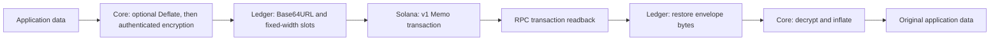

# DBrix

DBrix is a set of small TypeScript packages for encrypting application data, encoding binary payloads as text slots, and carrying those payloads in Solana Memo transactions. Each package owns one stage and can be used independently.

The same pipeline can support an append-only encrypted message log: an application encrypts a message with Core, encodes it with Ledger, and writes it to a Solana Memo through Solana. DBrix supplies those data-handling building blocks; the application must provide recipient key exchange, conversation indexing, and identity or access policy. The transaction memo and its metadata remain public.

## Packages

| Package | Responsibility |
| --- | --- |
| `@dbrix/core` | Authenticated encryption and optional lossless Deflate compression before encryption. |
| `@dbrix/ledger` | Reversible Base64URL encoding of bytes into fixed-width text slots. |
| `@dbrix/solana` | Solana v1 Memo transaction submission, Wallet Standard signing, and RPC readback. |

The packages compose as **Core → Ledger → Solana → Ledger → Core**. Core compresses eligible plaintext and encrypts it. Ledger encodes the serialized envelope into text slots. The Solana adapter puts the resulting text in a Memo instruction. Readback reverses those steps and Core decrypts the recovered envelope.



## Compression result

The captured run in [tx-comp-result.md](./tx-comp-result.md) used distinct random 32-byte commitment-shaped values rather than repeated characters. The values model realistic length and entropy but are synthetic; they are not derived from TCAP or GPRU protocol inputs. In that fixture, Deflate reduced the serialized encrypted envelope from **1,194 bytes to 830 bytes** and the Memo text payload from **1,592 bytes to 1,107 bytes**, a **30.5% reduction**. The recorded Solana v1 Memo send/read/decrypt round trip also completed successfully.

This is one measured fixture, not a guaranteed compression ratio. Compression helps repeated structure such as JSON field names, while random or already-compressed content may not shrink. Core skips compression when it would increase the typed plaintext size. Compression occurs before encryption, so the marker and resulting ciphertext length are visible; consider that length signal when deciding whether to compress sensitive data mixed with attacker-controlled input.

## Example from the full pipeline

The integration fixture models a TCAP credit of `1,250,000` base units for the Devnet USDC mint. Core encrypts the record, Ledger represents its 830-byte envelope as 1,107 Base64URL Memo characters, and the Solana adapter submits and reads the Memo. In the captured run, the transaction confirmed at slot `515844796` with signature `4oMico9PurQoNgPbAX9qVw62SyByAmJF49YiKbBSaa7k13HyTNVe7ZBuyQjLcXwCMJVi5stwF8YXcGiXiWkzcb3e`; the final Core decryption matched the input record. The commitment-shaped values are randomly generated test fixtures, so this demonstrates the data path and round-trip integrity rather than a real TCAP balance transition. The detailed input and output are recorded in [tx-comp-result.md](./tx-comp-result.md).

## Install after publication

The package manifests define the intended npm names. Install each published package independently:

```sh
npm install @dbrix/core @dbrix/ledger @dbrix/solana
```

The source tree is organized as separate package directories. Build a package from its directory before publishing:

```sh
cd core
npm install
npm run build
```

Repeat for `ledger` and `solana`. Publishing is not performed by these commands; release versions and npm publication are separate steps.

## Local demonstrations

The package-level tests show each component. The root suite shows the complete local round trip and skips Devnet unless explicitly enabled.

```powershell
cd C:\Users\codepara\Desktop\packages\drix\core
npm run test:core

cd C:\Users\codepara\Desktop\packages\drix\ledger
npm run test:ledger

cd C:\Users\codepara\Desktop\packages\drix
$env:DBRIX_RUN_DEVNET_ROUNDTRIP = "0"
npm run test:dbrix
```

The Devnet integration test submits a real transaction and charges its signer. It is intentionally opt-in. See [Solana package instructions](./solana/README.md) before enabling it.

## Current boundaries

- Core encryption and decryption are implemented with NaCl secretbox. Compression is optional and lossless.
- Ledger is an encoding and slotting layer; it does not encrypt or compress.
- The Solana package currently sends a standalone Memo transaction using the v1 transaction path and reads it back through an RPC URL. It does not yet compose a DBrix Memo instruction into an existing TCAP settlement transaction.
- The application supplies the RPC URL to every Solana send or read call; DBrix does not select a provider or cluster.

Built with love by **Agbaka Daniel Ugonna (Big Dreams Web3)**.
